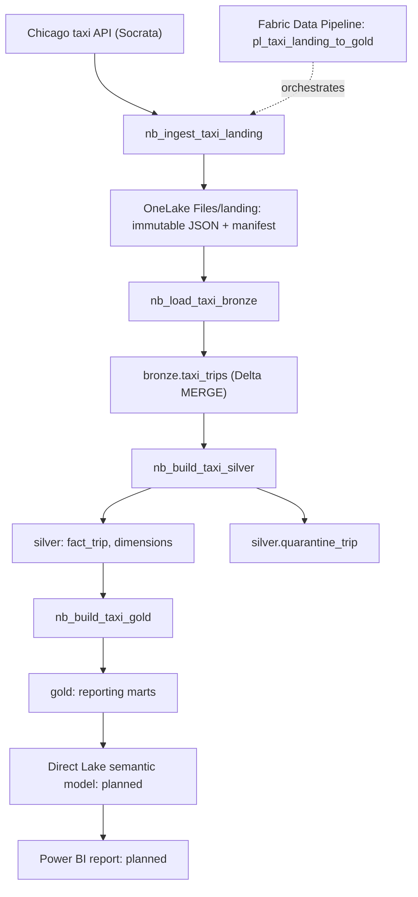

# Chicago Taxi Fabric Lakehouse

An API-to-report ETL pipeline on **Microsoft Fabric**: a Fabric Data Pipeline orchestrates Fabric
Spark notebooks that land Chicago taxi trips in OneLake and build bronze, silver and gold Delta
tables in one schema-enabled lakehouse. It is the Fabric counterpart of
[chicago-taxi-azure-lakehouse](https://github.com/papiloso01/chicago-taxi-azure-lakehouse)
(ADF + Databricks + ADLS), with the same data rules and test discipline.

## Current status

| Component | Status |
|---|---|
| Fabric workspace, capacity and Git integration | To be created by the project owner ([setup](docs/fabric_setup.md)) |
| Taxi API → OneLake landing | Implemented and tested offline |
| Bronze / silver / gold transformations | Implemented and tested offline on local PySpark |
| Fabric items (lakehouse, environment, notebooks, pipeline) | Defined in Git format; first workspace sync pending |
| Live Fabric run and backfill | Not yet run |
| Direct Lake semantic model and Power BI report | Planned |

CI is offline and does not verify any Fabric workspace. Nothing is deployed or scheduled by this repository.

## Architecture



See [architecture](docs/architecture.md), [Fabric setup](docs/fabric_setup.md),
[mapping from the Azure repo](docs/azure_to_fabric.md) and [roadmap](docs/roadmap.md).

## Layout

| Directory | Responsibility |
|---|---|
| `fabric/` | Fabric workspace items in Git-integration format (lakehouse, environment, notebooks, pipeline) |
| `src/chicago_taxi_fabric/` | Reusable extraction and bronze/silver/gold code, packaged as a wheel for the Fabric Environment |
| `metadata/` | Versioned source definitions, reporting rules and table contracts |
| `tools/` | Offline validators for metadata and Fabric item structure |
| `tests/` | Functional, loopback HTTP integration, Spark ETL validation and offline end-to-end suites |
| `config/` | Example environment settings (copy to `dev.local.yml`, which Git ignores) |

## Local checks (Windows CMD)

Use Python 3.11 and Java 17 to match Fabric Runtime 1.3 (Spark 3.5).

```cmd
python -m venv .venv
.venv\Scripts\activate
python -m pip install -e ".[test,spark-test]"
python tools/validate_metadata.py
python tools/validate_fabric_items.py
python -m pytest -v
```

No Fabric or Azure credentials are needed. If PySpark reports a worker/driver Python mismatch,
set `PYSPARK_PYTHON` to the virtual environment's `python`.

## Reporting limits

Taxi IDs identify vehicles, not drivers. Trip charges are not driver profit. Passenger gender is
absent. Miles × 1.609344 gives reported km, not a road route. Missing revenue or distance stays
null and is reported through coverage measures; trips with missing geography are kept as area 0.
Pickup and dropoff area activity are separate roles and must not be summed.

Keep credentials and `.env` out of Git; use Azure Key Vault for any API token. Keep PR review
before merging. Code is MIT licensed; source data retains its provider terms.
